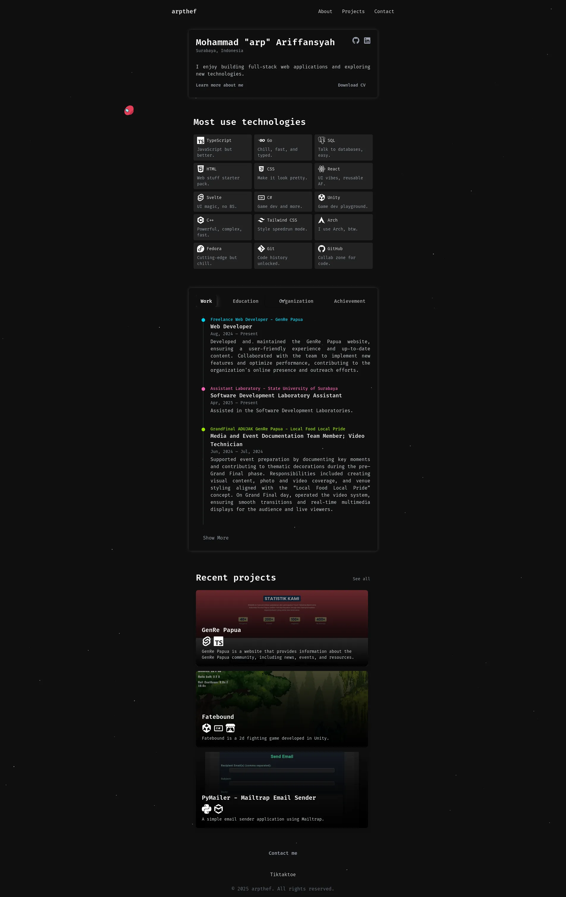
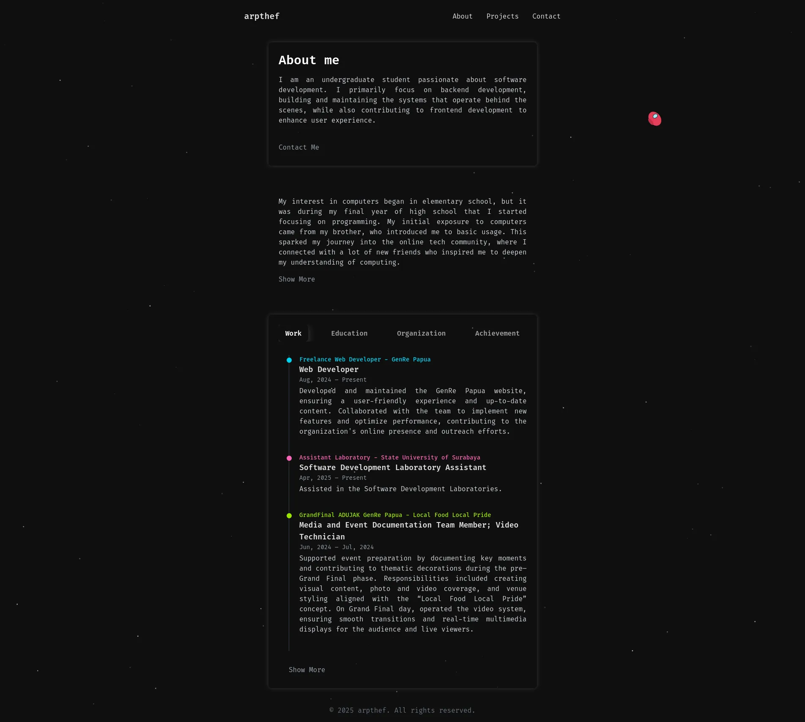
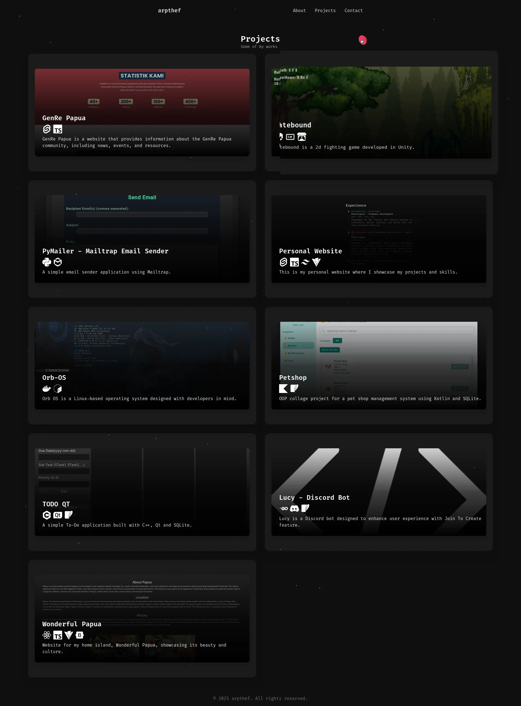
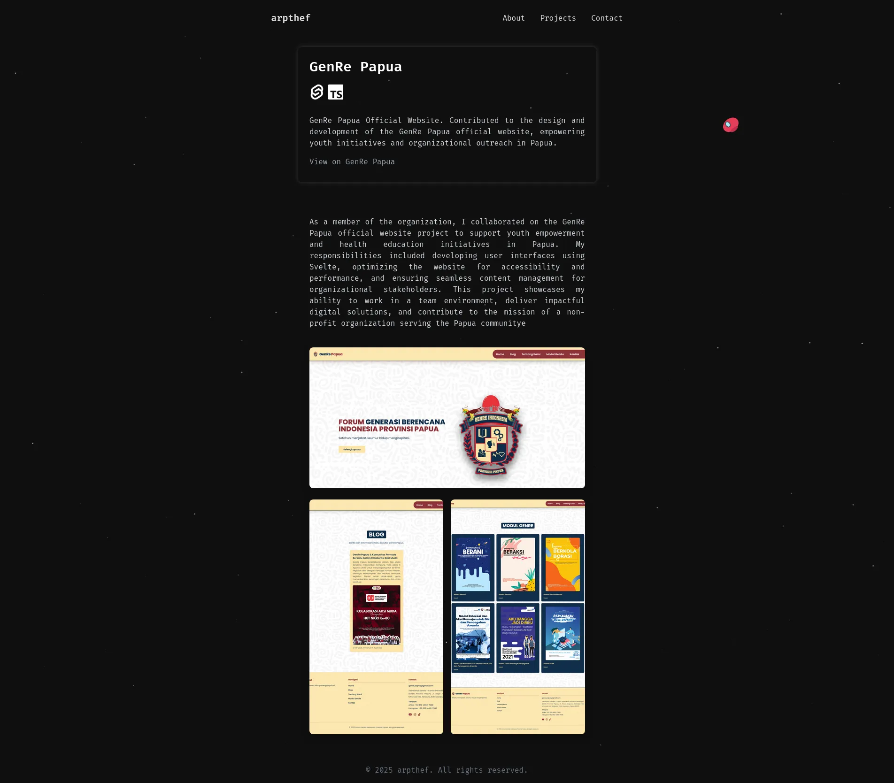
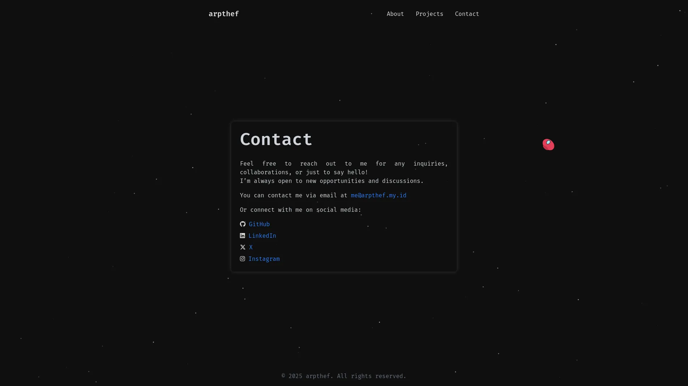

# arpthef - Personal Web Portfolio

Welcome to my personal web portfolio project!  
This repository contains the source code for [arpthef](https://github.com/Ariffansyah/arpthef), built to showcase my work, skills, and background as a developer.

## Tech Stack

- **Framework:** [Svelte](https://svelte.dev/)
- **Languages:** TypeScript, JavaScript, HTML, CSS
- **Runtime & Package Manager:** [Bun](https://bun.sh/)

## Features

- Modern, responsive design
- Interactive components and smooth navigation
- Projects and experience showcased
- Contact information

## Screenshots
|  |  |  |
|------------------------------------------|------------------------------------------|------------------------------------------|
|  |  |                                          |
## Getting Started (with Bun)

To run this project locally using Bun:

```bash
git clone https://github.com/Ariffansyah/arpthef.git
cd arpthef

bun install

bun run dev
```

Then open [http://localhost:5173](http://localhost:5173) in your browser.

## Build

To build for production with Bun:

```bash
bun run build
```

## Learn More

- [Svelte Documentation](https://svelte.dev/docs)
- [TypeScript Handbook](https://www.typescriptlang.org/docs/)
- [Bun Documentation](https://bun.sh/docs)

## About Me

I'm Ariffansyah, a passionate developer interested in web technologies, design, and user experience.  
Feel free to reach out via the contact section of this site or through GitHub issues.

## License

This project is open source and available under the [MIT License](LICENSE).

The 3D models in `static/models/` are not covered by the MIT License. Both are licensed under [CC BY 4.0](https://creativecommons.org/licenses/by/4.0/) and were slimmed down (`scripts/slim-model.mjs`) and restyled as comic art at runtime:

- `gwen.glb`: [Spider-Gwen - Across the Spider-Verse](https://sketchfab.com/3d-models/spider-gwen-across-the-spider-verse-297c91b697f7428ea634ab454a598219) by [Kabiidev](https://sketchfab.com/kabiidev)
- `miles.glb`: [Fortnite Miles Morales](https://sketchfab.com/3d-models/fortnite-miles-morales-2eeed4f44ff64efda054b83325146842) by [sinner.chd](https://sketchfab.com/sinner.chd)

---

Thank you for visiting my portfolio!
